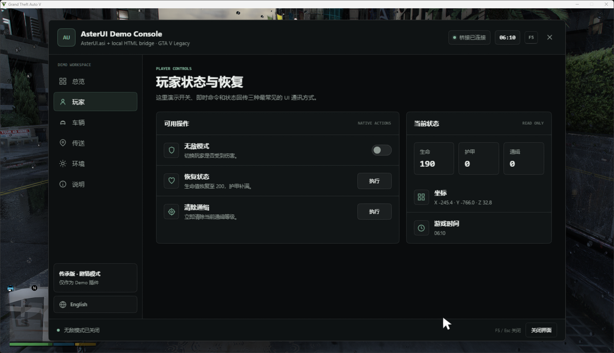

# AsterUI

[Chinese](README.md) | [English](README.en.md) | [Documentation](https://hunter-lies.github.io/AsterUI/en/)

[](LICENSE)
[](https://hunter-lies.github.io/AsterUI/en/)

<p align="center">
  
</p>

Local HTML/CSS/JavaScript UI runtime for **Grand Theft Auto V Legacy Edition on Windows, Story Mode**. Responsibilities are similar to RageUI: AsterUI owns page lifecycle, CEF rendering, input, and JSON messaging; a plugin owns page launch policy and game actions.

In this documentation, "plugin" means the ASI/RPH plugin that hosts AsterUI pages, receives page events, and calls game functions.

AsterUI does not support the GTA V Enhanced Edition, FiveM, RedM, or GTA Online. The runtime requires an ASI/RPH plugin. The repository does not contain the game, ScriptHookV, or Rockstar game files.

> This documentation covers UI authoring only. Plugin, native, and hook development are outside its scope.

## Quick start

1. Copy `examples/hello-overlay` to `AsterUI/ui/my-ui/`.
2. Use `index.html` as the entry point.
3. Wait for the bridge:

```js
window.addEventListener("asterui:ready", () => {
  window.asterui.on("myui:state", (state) => {
    console.log(state);
  });

  window.asterui.emit("myui:request", {});
});
```

4. Include `sdk/js/mock.js` for browser preview.

## UI model

```text
HTML interaction
  -> window.asterui.emit("myui:action", payload)
  -> game plugin
  -> plugin sends myui:state
  -> window.asterui.on receives JSON
  -> HTML update
```

AsterUI owns page lifecycle, rendering, mouse and keyboard input, resource allowlists, and JSON event transport. The plugin owns event semantics, launch policy, hotkeys, and game actions.

## Documentation

- [Getting started](https://hunter-lies.github.io/AsterUI/en/getting-started)
- [Full UI guide](https://hunter-lies.github.io/AsterUI/en/ui-guide)
- [JavaScript bridge](https://hunter-lies.github.io/AsterUI/en/js-api)
- [Preview and HMR](https://hunter-lies.github.io/AsterUI/en/development)
- [Architecture and scope](https://hunter-lies.github.io/AsterUI/en/architecture)
- [Troubleshooting](https://hunter-lies.github.io/AsterUI/en/troubleshooting)

## Examples

- `demo-ui`: player state and actions, vehicle controls, GTA waypoint and destination teleport, time and weather controls, and Chinese/English language switching.
- `hello-overlay`: minimal bridge handshake.
- `interactive-menu`: tabs, switches, pointer input.
- `notification`: event-driven notification.
- `vite-starter`: localhost HMR.

`AsterUI.Demo.asi` is the public demo plugin and is not part of the UI authoring tutorial.

## Contributors

<p align="center">
  <a href="https://github.com/Hunter-Lies/AsterUI/graphs/contributors">
    
  </a>
</p>

Contributor avatars are generated from merged commit history. See [CONTRIBUTORS.en.md](CONTRIBUTORS.en.md).

## Engine maintainers

```powershell
.\scripts\bootstrap.ps1 -ScriptHookVSdk C:\SDK\ScriptHookV
.\scripts\build.ps1
.\scripts\package.ps1
.\scripts\test.ps1
```

Documentation development:

```powershell
npm install
npm run docs:dev
```

## License

MIT. See [LICENSE](LICENSE) and [THIRD_PARTY_NOTICES.md](THIRD_PARTY_NOTICES.md).
