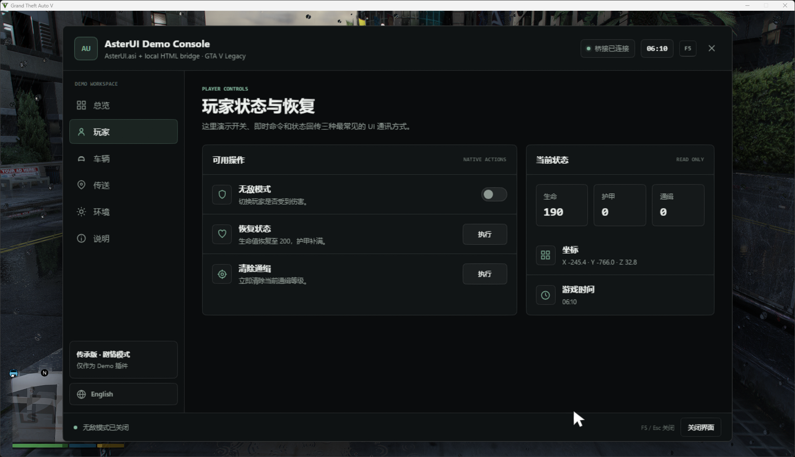

# AsterUI

[简体中文](README.md) | [English](README.en.md) | [文档站](https://hunter-lies.github.io/AsterUI/)

[](LICENSE)
[](https://hunter-lies.github.io/AsterUI/)

<p align="center">
  
</p>

面向 **Grand Theft Auto V PC 传承版（Legacy，非增强版）单机剧情模式（Windows）** 的本地 HTML/CSS/JavaScript UI 运行时，定位类似 RageUI：AsterUI 负责页面生命周期、CEF 渲染、输入和 JSON 通讯；插件负责何时显示页面以及如何处理游戏功能。

本文所说的“插件”指加载 AsterUI 页面、接收页面事件并调用游戏功能的 ASI/RPH 插件。

不支持 GTA V 增强版（Enhanced）、FiveM、RedM 或 GTA Online。运行时需要由 ASI/RPH 插件加载；仓库不包含游戏本体、ScriptHookV 或 Rockstar 游戏文件。

> 本项目文档只覆盖 UI 开发。插件、Native 和钩子开发不属于 AsterUI UI 教程范围。

## 快速开始

1. 复制 `examples/hello-overlay` 到 `AsterUI/ui/my-ui/`。
2. 页面入口使用 `index.html`。
3. 等待桥接就绪：

```js
window.addEventListener("asterui:ready", () => {
  window.asterui.on("myui:state", (state) => {
    console.log(state);
  });

  window.asterui.emit("myui:request", {});
});
```

4. 普通浏览器预览时引入 `sdk/js/mock.js`。

## 页面模型

```text
HTML 交互
  -> window.asterui.emit("myui:action", 数据)
  -> 游戏插件
  -> 插件发送 myui:state
  -> window.asterui.on 接收 JSON
  -> HTML 更新
```

AsterUI 只负责页面生命周期、渲染、鼠标键盘输入、资源白名单和 JSON 事件传输。事件名称、页面启动策略、热键和游戏功能由插件定义。

## 文档

- [快速开始](https://hunter-lies.github.io/AsterUI/getting-started)
- [完整 UI 教程](https://hunter-lies.github.io/AsterUI/ui-guide)
- [JavaScript 通讯](https://hunter-lies.github.io/AsterUI/js-api)
- [预览与热重载](https://hunter-lies.github.io/AsterUI/development)
- [架构与边界](https://hunter-lies.github.io/AsterUI/architecture)
- [故障排查](https://hunter-lies.github.io/AsterUI/troubleshooting)

## 示例

- `demo-ui`：玩家状态与操作、车辆操作、GTA 地图路点与地点传送、时间天气控制和中英文切换。
- `hello-overlay`：最小通讯示例。
- `interactive-menu`：标签页、开关和输入。
- `notification`：事件驱动通知。
- `vite-starter`：localhost HMR。

`AsterUI.Demo.asi` 只是公开 Demo 插件，不属于 UI 开发教程。

## 贡献者

<p align="center">
  <a href="https://github.com/Hunter-Lies/AsterUI/graphs/contributors">
    
  </a>
</p>

贡献者头像根据已合并提交自动生成。维护者和贡献者规则见 [CONTRIBUTORS.md](CONTRIBUTORS.md)。

## 引擎维护

```powershell
.\scripts\bootstrap.ps1 -ScriptHookVSdk C:\SDK\ScriptHookV
.\scripts\build.ps1
.\scripts\package.ps1
.\scripts\test.ps1
```

文档开发：

```powershell
npm install
npm run docs:dev
```

## 许可证

MIT，详见 [LICENSE](LICENSE) 和 [THIRD_PARTY_NOTICES.md](THIRD_PARTY_NOTICES.md)。
